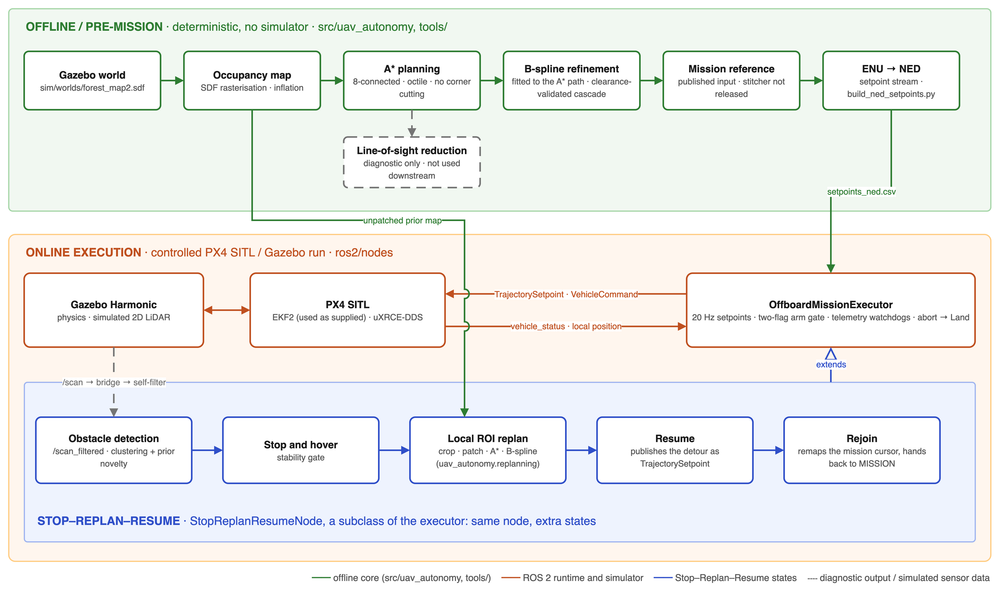
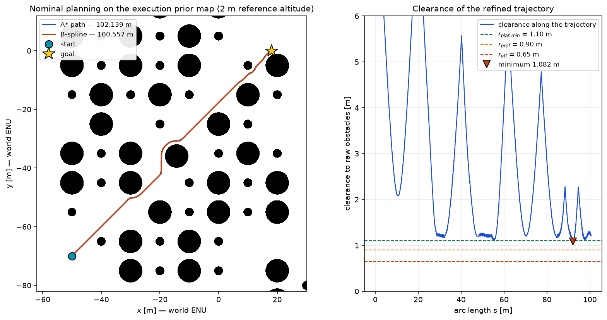
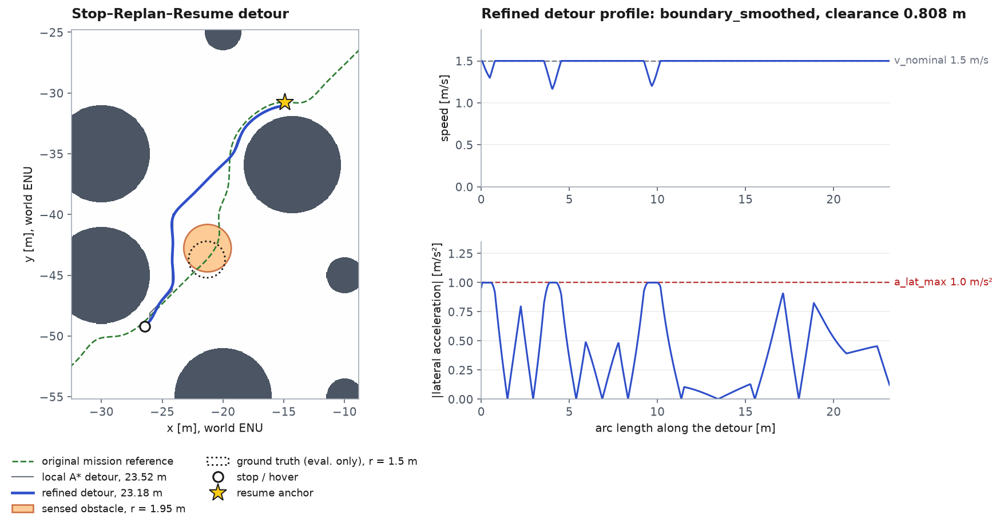

# Modular UAV Autonomy with ROS 2 and PX4

[](https://github.com/ahmxtt/ros2-px4-uav-autonomy/actions/workflows/ci.yml)

**Global planning, trajectory refinement, PX4 Offboard execution and
Stop–Replan–Resume obstacle response for a multirotor in cluttered forest
terrain. ROS 2 Jazzy · PX4 · Gazebo Harmonic · Python.**

> Master's thesis work, released as a curated implementation and evidence
> bundle rather than the full development history. Validated **offline and in
> PX4 SITL / Gazebo only**. There is no real-flight validation.

## At a glance

| | |
|---|---|
| **Problem** | Fly a pre-planned multi-POI mission (two legs out, a two-turn orbit at each point of interest, one leg back) through a forest at 2 m altitude, as in search-and-rescue or wildlife-monitoring use. When an obstacle that is not in the prior map appears in front of the vehicle, stop, plan a local detour and rejoin the original mission, without handing control back to a pilot. |
| **What I built** | A ROS-free Python core (map rasterisation, deterministic A\*, clearance-validated B-spline refinement, local ROI replanning, ENU↔NED frames, provenance artifacts) and two ROS 2 nodes on top of it: a PX4 Offboard mission executor with a two-flag arm gate and telemetry watchdogs, and a Stop–Replan–Resume node with 2D-LiDAR cluster detection. |
| **What I integrated** | PX4 SITL with its **EKF2 estimator, used as supplied**, the X500 SITL airframe, uXRCE-DDS, Gazebo Harmonic. No custom SLAM or sensor fusion. |
| **Reproducible from this repo** | The offline planning chain and the Stop–Replan–Resume detour geometry, checked against the published numbers in CI. |
| **Measured in SITL** | Nominal mission tracking, ground truth vs. PX4 estimate, one complete perception-driven Stop–Replan–Resume run. These are **single controlled runs recorded with the private development tree** and cannot be regenerated. |
| **Public runtime status** | The released code arms, enters Offboard and holds position in SITL, then aborts on a stale-telemetry watchdog **before** the mission phase. No armed run of this public code has completed a mission. |



*Green: offline core in `src/uav_autonomy/`. Orange: ROS 2 runtime in
`ros2/nodes/`. Blue: obstacle-response path. The B-spline is fitted to the A\*
path; line-of-sight reduction is a diagnostic side branch. The multi-POI
mission reference is published as a fixed input; the stitcher that produced
it is not part of this release.*

## Technical contributions

- **Deterministic 2D grid planning.** 8-connected A\* with an octile
  heuristic, no corner cutting, hard binary inflation and a total tie-break
  on `(f, g, row, col)`, so the published path regenerates cell for cell.
  Three edge-cost variants: geometric, clearance-penalised (local replan) and
  comfort-penalised (nominal mission).
- **A smoothing budget, followed by validation.** The nominal planner
  inflates to `r_plan_min` = 1.10 m, above the `r_pref` = 0.90 m the
  finished trajectory should hold, because a B-spline cuts corners. That
  budget is not a guarantee. Every candidate is validated on dense samples
  against the raw obstacles and classified by the clearance it actually
  reached: the nominal trajectory reached `robust_smoothed`, the local detour
  only `boundary_smoothed`.
- **Local ROI replanning.** The region of interest is derived from the motion
  envelope (turn radius, stopping distance, replan budget, obstacle size). The
  sensed obstacle is stamped into a crop of the prior map. The detour is
  planned from the hover pose to a downstream resume anchor and rejoins the
  untouched original reference.
- **Perception kept falsifiable.** In the perception-driven variant
  (Gate 6D-B), ground truth is held in an evaluation-only namespace and gates
  no decision.
- **Reproducibility as infrastructure.** Every stage writes a manifest,
  metrics and SHA-256 hashes. An incremental
  [validation-gate framework](docs/validation_gates.md) bounds the scope of
  each claim.

## Quickstart (offline — no ROS, PX4 or Gazebo)

```bash
git clone https://github.com/ahmxtt/ros2-px4-uav-autonomy.git
cd ros2-px4-uav-autonomy
python3 -m venv .venv && source .venv/bin/activate
pip install -e ".[test]"

pytest                                                        # 155 tests
python3 tools/reproduce_offline_demo.py --output-dir /tmp/uav_demo
python3 tools/reproduce_srr_geometry.py --output-dir /tmp/uav_srr
for d in results/*/; do (cd "$d" && sha256sum -c hashes.txt); done
```

Both reproduction tools rebuild the occupancy grid from the Gazebo world file,
rerun the canonical computation, compare against the published numbers and
exit non-zero on a regression. Each one ends in `RESULT : PASS`. On a laptop
the full test suite takes about a minute and the nominal demo about 20 s. On
macOS, use `shasum -a 256 -c` in place of `sha256sum -c`.

To run the SITL stack, see [docs/installation.md](docs/installation.md).

## Selected results

Every number carries its evidence class. **Do not combine numbers across
classes.** They come from different runs and measure different things.

| Class | Meaning | Reproducible from this repository |
|---|---|---|
| **1** | Offline nominal planning | yes: A\* cell path and counters exact, trajectory metrics to 1e-9 |
| **2** | Offline Stop–Replan–Resume geometry | yes: A\* exact, refined detour to 1e-6 m |
| **3** | Canonical controlled SITL evidence (thesis) | no: single runs, private development tree, raw logs not published |
| **4** | Public-release runtime validation | records an **incomplete** run, see below |

| Result | Value | Class |
|---|---|---|
| A\* path, single leg | 102.139 m (straight line 97.541 m), 230 047 nodes expanded, min. clearance 1.200 m | 1 |
| B-spline trajectory | 100.557 m, min. clearance 1.082 m → `robust_smoothed`, max. deviation from A\* 0.252 m | 1 |
| Nominal tracking, setpoint vs. PX4 estimate, n = 2922 | horizontal mean / RMSE 0.220 / 0.234 m, p95 / max 0.378 / 0.609 m, 1.0 m budget not breached | 3 |
| Ground truth vs. PX4 estimate, airborne, n = 14 869 | horizontal RMSE 0.226 m; consistency check of the integration, **not** an estimator benchmark | 3 |
| Local detour geometry | 23.178 m, min. clearance 0.808 m → `boundary_smoothed` (≥ `r_eff` 0.65 m, **below** `r_pref` 0.90 m) | 2 |
| Handover continuity | position jump 0.245 m, yaw jump 11.07° | 2 (reproduced), 3 (flown) |
| Stop–Replan–Resume run | online replan 0.251 s (budget 3 s), rejoin distance 0.006 m, mission completed, no failsafe, max. tracking error 0.802 m | 3 |

<p>
  
  
</p>

*Both figures are generated offline by `tools/make_docs_figures.py` from the
published results. They show computed geometry, not flight recordings.*

**Class 4, public runtime validation**
([`results/public_runtime_validation/`](results/public_runtime_validation/README.md)).
The physical obstacle spawn into Gazebo is **verified**: the world went from
88 to 89 models, the model occurs exactly once, and the pose read back equals
the requested (−21.330, −43.710, 1.500) m. The armed perception-driven run is
**not completed**. It armed, entered Offboard and held the settle setpoint
(lateral error ≤ 0.060 m), then aborted on `lpos_stale` and landed cleanly. On
that machine uXRCE-DDS delivered `vehicle_local_position` with gaps up to
1.24 s against the 0.5 s watchdog. The run never reached `MISSION`, so no
detection, stop, replan, resume or rejoin was exercised. The watchdog
thresholds were not relaxed.

Full tables, metric definitions and provenance are in
[docs/results.md](docs/results.md).

## Planning geometry: X650 geometry, X500 dynamics

Planning geometry is sized toward the Holybro X650. The only radius any code
reads is `r_eff` = 0.65 m (`sim/config/robot_map2_safe.yaml`). It is the
0.5155 m propeller-tip envelope (650 mm wheelbase, 15 inch propellers) plus a
chosen 0.1345 m margin: a planning envelope, not a measured airframe
dimension. Mass, inertia, propulsion and closed-loop dynamics are those of
the PX4 **X500** SITL model. Execution results are therefore
X650-geometry-informed SITL results. For the full derivation and the rejected
0.50 m radius, see
[docs/results.md](docs/results.md#x650-geometry-x500-dynamics).

## Tests and CI

[GitHub Actions](.github/workflows/ci.yml) runs on Python 3.10 and 3.12:

- the `pytest` suite: planner invariants, frame transforms, geometry
  semantics, cell-for-cell regression against the published path, and SRR
  replanning;
- both offline reproduction tools, invoked from a foreign working directory;
- byte-exact regeneration of the canonical PX4 setpoint stream (SHA-256
  `bcc70fb8…`);
- assembly of the SRR runtime inputs, and hash verification of every result
  bundle.

**The ROS 2 nodes are only byte-compiled in CI.** No ROS, PX4 or Gazebo is
installed there, so CI checks syntax, not runtime behaviour. Runtime checks
were done by hand against a local SITL stack:
[docs/reproducibility.md](docs/reproducibility.md#ros-2-runtime-verification).

## Limitations

- Validated in **offline computation and PX4 SITL / Gazebo only**. No
  autonomous real-flight validation.
- **No custom SLAM or sensor-fusion method.** State estimation is PX4's EKF2.
- Global planning is **2D at a constant 2 m reference altitude**. Tree
  canopies at that altitude are rasterised into the prior map; the planner
  does not search in 3D.
- Detection uses a single-plane 2D LiDAR. Stop–Replan–Resume was validated
  for **one** static obstacle.
- Evidence comes from **single controlled runs**, not repeated trials. No
  success rate is reported and no statistical robustness is claimed.
- **No armed run of the public code has completed a mission.** The completed
  missions are class 3, recorded with the private development tree.
- Known runtime defects in `ros2/nodes/` are documented, not fixed: a
  single-shot Land command with a time-based force-disarm fallback, and a
  replan that blocks the setpoint stream. See
  [docs/limitations.md](docs/limitations.md#known-runtime-defects-documented-not-fixed).
- **Not safety-certified.**

Full list: [docs/limitations.md](docs/limitations.md) ·
[docs/safety.md](docs/safety.md).

## Repository structure

| Path | Contents |
|---|---|
| `src/uav_autonomy/` | Algorithmic core: mapping, grid, planning, smoothing (LoS), trajectory, replanning, frames, artifacts. No ROS. |
| `ros2/nodes/` | PX4 Offboard mission executor and the Stop–Replan–Resume node. Requires ROS 2 and `px4_msgs`. |
| `tools/` | Thin CLIs over the core, the two reproduction tools, `build_ned_setpoints.py`, the figure generator. SITL helpers: `sitl_stack.sh`, `spawn_srr_obstacle.py`, `gcs_heartbeat.py`, `build_srr_inputs.py`. |
| `sim/` | Gazebo world, the unknown-obstacle model (absent from the prior map by design), robot and mission-policy configuration. |
| `results/` | Curated result bundles with metrics, manifests and SHA-256 hashes, including the complete mission reference and `public_runtime_validation/`. |
| `tests/` | Invariant and regression tests. |
| `docs/` | See below. |

## Documentation

| Document | Read it for |
|---|---|
| [architecture.md](docs/architecture.md) | Module responsibilities, the ROS runtime state machines, frame conventions |
| [results.md](docs/results.md) | Every published number, its definition and its result class |
| [reproducibility.md](docs/reproducibility.md) | What regenerates exactly, what regenerates to tolerance, and what cannot regenerate |
| [data_availability.md](docs/data_availability.md) | Contents of each bundle, and what the hashes do and do not prove |
| [validation_gates.md](docs/validation_gates.md) | The gate framework and the scope of each claim |
| [limitations.md](docs/limitations.md) · [safety.md](docs/safety.md) | Scope, known defects, the arm gate and watchdogs |
| [installation.md](docs/installation.md) | Offline setup and the full SITL stack |

## Data availability

The offline results are independently reproducible. The canonical SITL
summaries are curated evidence: the raw per-tick logs behind them stay in the
private research archive (available on reasonable request), so the hashes
prove the integrity of the published files, not that they were correctly
derived from those logs. The complete multi-POI mission reference is
published as a fixed input; it is not regenerated here. Details:
[docs/data_availability.md](docs/data_availability.md).

## Citation, third-party content, licence

See [CITATION.cff](CITATION.cff), or use GitHub's "Cite this repository"
button. The world references the Gazebo Fuel models *Pine Tree* and
*Oak tree* (OpenRobotics, CC0 1.0); their meshes are not included. Full
attribution is in [NOTICE.md](NOTICE.md). Code is licensed under
[Apache-2.0](LICENSE); data, figures and result bundles under
[CC BY 4.0](LICENSE-DATA).
